<nav class="portfolio-nav" aria-label="Portfolio navigation">
  <a class="portfolio-brand" href="#top">KA</a>
  

    <a href="#experience">Mechanical Design</a>
    <a href="#bwb">Aerodynamics</a>
    <a href="#hycube">Flight Hardware</a>
    <a href="#drone">Vehicle Integration</a>
    <a href="#rotorcraft">Flight Dynamics</a>
  

</nav>

<section class="hero-compact">
  

    
UC BERKELEY · MECHANICAL ENGINEERING ’28

    <h1>Kevin Armstrong II</h1>
    
Mechanical Design, Build &amp; Test · Aerodynamics &amp; Flight Hardware.

    

      I design, build, integrate, and test mechanical and flight hardware, using structural analysis, CFD,
      and measured results to guide design decisions.
    

    

      <a class="hero-link" href="https://app.notion.com/p/Zipline-Aerodynamics-Presentation-Kevin-Armstrong-II-3f1f045049e780f89fbadf1b7cc8d9f6"
         target="_blank" rel="noopener noreferrer">Aerodynamics Specific Work</a>
      <a class="hero-link" href="https://www.linkedin.com/in/kevin-armstrong-ii-647125319/"
         target="_blank" rel="noopener noreferrer">LinkedIn</a>
      <a class="hero-link" href="https://mail.google.com/mail/?view=cm&amp;fs=1&amp;to=kevarm2028@berkeley.edu"
         target="_blank" rel="noopener noreferrer">Email</a>
    

  

  
</section>

<section class="experience-brief" aria-label="Engineering focus">
  

    MECHANICAL DESIGN + TEST
    <strong>Standard Bots</strong>
    
High-load test hardware · mechanical interfaces · robot assembly · validation

  

  

    AIRCRAFT AERODYNAMICS
    <strong>Blended-Wing-Body Aircraft</strong>
    
Outer-mold-line design · CFD verification · wind-tunnel testing · flow visualization

  

  

    FLIGHT DYNAMICS RESEARCH
    <strong>UC Berkeley</strong>
    
Aerodynamic force/moment modeling · nonlinear simulation · IEEE Aerospace 2027

  

</section>

<section id="featured-work" class="featured-work">
  <header class="section-heading">
    
SELECTED ENGINEERING

    <h2>Work</h2>
  </header>

  

    <a class="featured-card" href="#experience">
      

        
      

      

        MECHANICAL DESIGN + TEST
        <h3>Standard Bots</h3>
        
High-load test infrastructure, mechanical interfaces, structural analysis, assembly, calibration, and validation.

        <strong class="card-result">100 hr loaded burn-in</strong>
      

    </a>

    <a class="featured-card" href="#bwb">
      

        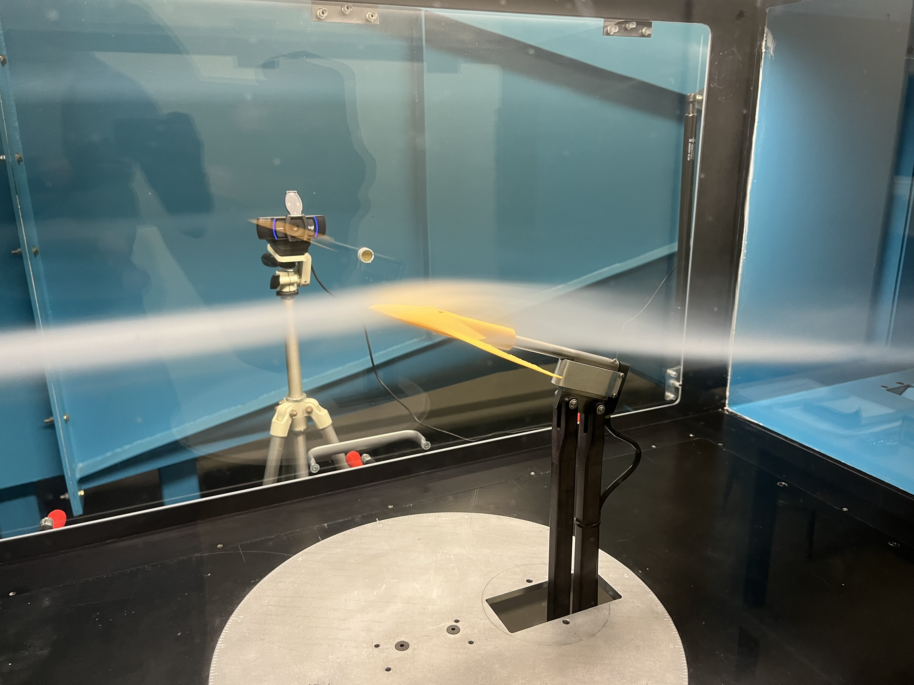
      

      

        AERODYNAMICS + EXPERIMENTAL VALIDATION
        <h3>Blended-Wing-Body Aircraft</h3>
        
Two linked test articles: the first mapped separation; the revised model explores its flow and force trends.

        <strong class="card-result">CAD → fabrication → physical test</strong>
      

    </a>

    <a class="featured-card" href="#rotorcraft">
      

        <video autoplay muted loop playsinline preload="metadata"
               aria-label="Matched AH-1S recovery comparison">
          <source src="assets/ah1s_matched_recovery_20s.mp4" type="video/mp4">
        </video>
      

      

        FLIGHT DYNAMICS + MODEL VALIDATION
        <h3>Learned Flight Dynamics</h3>
        
Aerodynamic force/moment modeling, nonlinear 6-DOF simulation, local stability analysis, and controller-facing validation.

        <strong class="card-result">IEEE Aerospace 2027 · Accepted</strong>
      

    </a>

    <a class="featured-card" href="#hycube">
      

        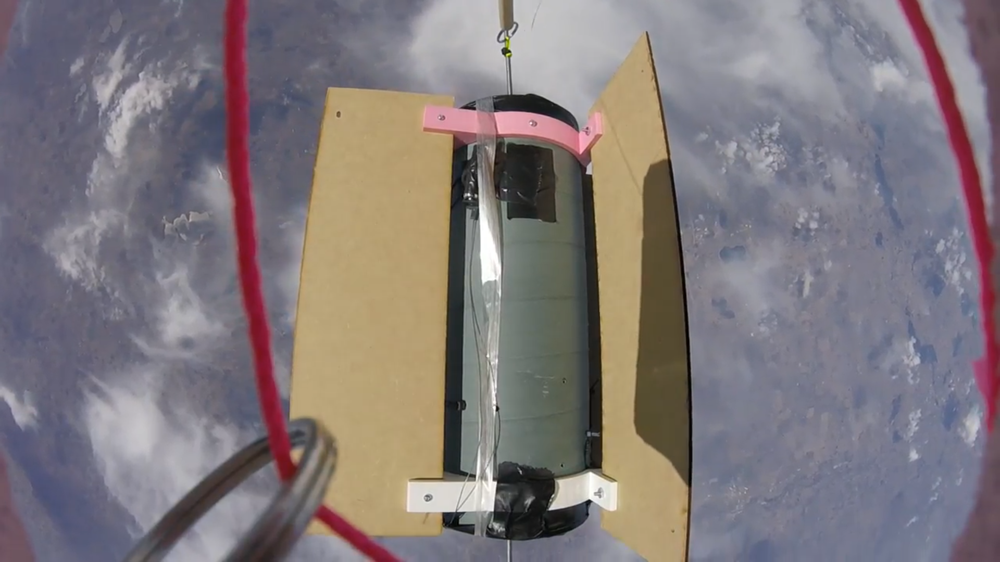
      

      

        AEROSPACE HARDWARE + TEST
        <h3>HyCUBE Reentry Vehicle</h3>
        
Thermal instrumentation, calibration, payload integration, flight operations, recovery, and post-flight validation.

        <strong class="card-result">~90,000 ft flight</strong>
      

    </a>
  

</section>

<section id="experience" class="case-study standardbots-case">
  <header class="case-header standardbots-header">
    

      
PROFESSIONAL EXPERIENCE · SUMMER 2026

      

        <h2>Standard Bots</h2>
        Series C industrial robotics startup
      

      
Mechanical Design &amp; Test Intern · high-load test infrastructure · Long Island, New York

    

  </header>

  

    Designed and commissioned mechanical hardware and test infrastructure for six-axis industrial robots across CAD,
    load-path analysis, static FEA, fabrication, assembly, instrumentation, and validation.
    My work focused on applying representative loads, screening joint reliability before full robot assembly,
    and building robust interfaces for high-load production test equipment.
  

  

    

      <strong>100 hr</strong>
      automated loaded burn-in
    

    

      <strong>&gt;2.5 kN·m</strong>
      momentary interface load verified
    

    

      <strong>1st at company</strong>
      loaded joint screening before full robot assembly
    

  

  

    <figure class="figure-card">
      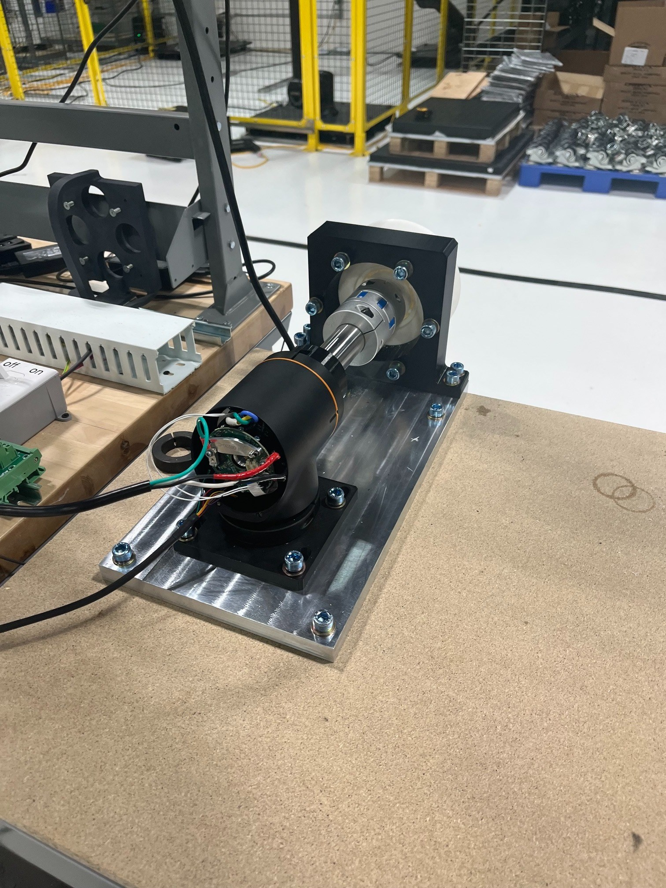
      <figcaption>
        <strong>Automated loaded burn-in fixture.</strong>
        Built station used to screen joints under representative load before full robot assembly.
      </figcaption>
    </figure>

<figure class="figure-card">
  <video class="cad-video"
         autoplay muted loop playsinline controls preload="metadata"
         poster="assets/standardbots_test_hardware.jpg">
    <source src="assets/Loaded%20Burn-in%20View%20+%20Still.mp4" type="video/mp4">
  </video>
  <figcaption>
    <strong>Exploded CAD sequence.</strong>
    Fixture architecture, coupling stack, support structure, and test-side interfaces coming together.
  </figcaption>
</figure>

  

  

    <article>
      01
      <h3>Automated load-testing station</h3>
      

        Designed an automated pre-assembly burn-in station that applied representative torque during long-duration cycling,
        integrated torque and position sensing, and screened joints before complete robot assembly.
      

    </article>

<article>
  02
  <h3>High-load dynamometer interface</h3>
  

    Designed a precision mechanical interface and checked bolted, doweled, keyed, and shaft load paths
    with hand calculations and static FEA before releasing the manufactured part.
  

</article>

<article>
  03
  <h3>Assembly, checkout + production support</h3>
  

    Assembled and calibrated three complete robot arms, programmed checkout motion routines,
    improved technician-facing build instructions, and trained technicians.
  

</article>

  

  

    <figure class="figure-card assembly-photo">
      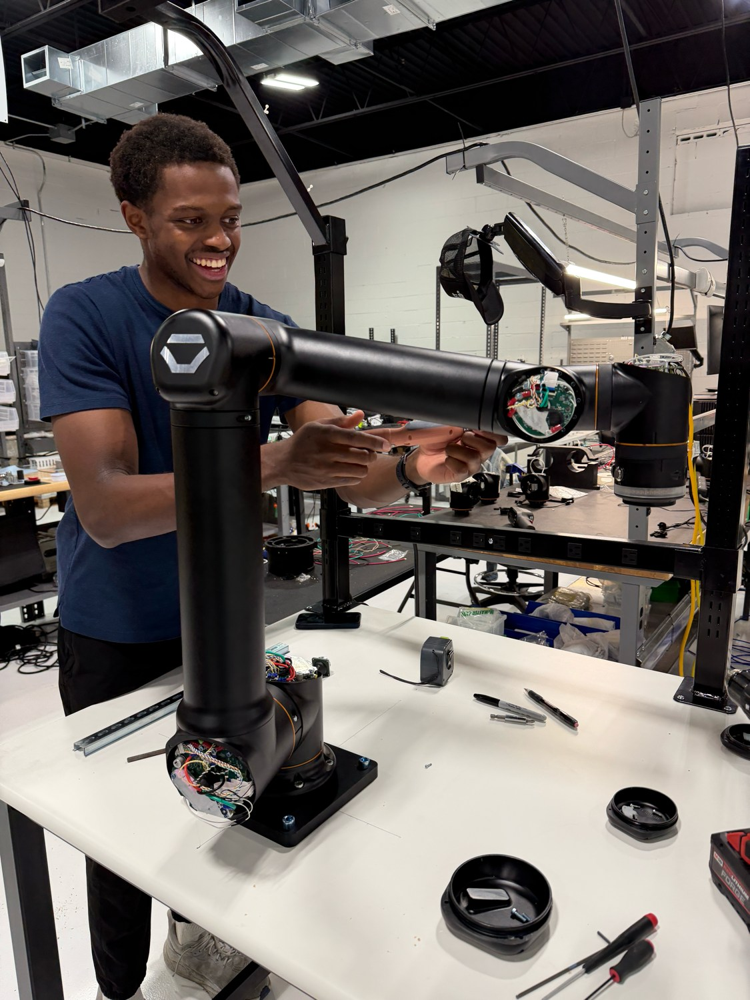
      <figcaption>
        <strong>Assembly + calibration.</strong>
        Bringing up and validating a completed robot arm.
      </figcaption>
    </figure>

<figure class="figure-card">
  <video autoplay muted loop playsinline controls preload="metadata"
         poster="assets/standardbots_motion_poster.jpg">
    <source src="assets/standardbots_motion_routine.mp4" type="video/mp4">
  </video>
  <figcaption>
    <strong>Checkout routine.</strong>
    Arm executing a motion routine I programmed while bringing up the completed assembly.
  </figcaption>
</figure>

  

</section>

<section id="bwb" class="case-study">
  <header class="case-header split">
    

      
AIRCRAFT DESIGN · EXPERIMENTAL AERODYNAMICS

      <h2>Blended-Wing-Body Aircraft Design &amp; Testing</h2>
      
Two BWB iterations · first test: CFD and tufts · second test: revised model and fog

    

<a class="text-link" href="assets/BWB_Project_Showcase_Tufts%20(4).html">First test technical showcase ↗</a>

  </header>

  <h3 id="bwb-second" class="bwb-campaign-heading">Revised model · Second test</h3>

  

    <figure class="figure-card bwb-fog-photo">
      
      <figcaption><strong>New configuration.</strong> Fog visualization in the wind tunnel.</figcaption>
    </figure>
    <figure class="figure-card bwb-fog-video">
      <video autoplay muted loop playsinline controls preload="metadata" poster="assets/bwb_fog_hero.jpg"
             aria-label="Fog visualization around the new blended-wing-body model">
        <source src="assets/bwb_fog_flow.mp4" type="video/mp4">
        Your browser does not support this video.
      </video>
      <figcaption><strong>Flow in motion.</strong> Watch the fog move past the model.</figcaption>
    </figure>
  

  

    The fog test above is my second BWB test article. The first combined CFD, force-balance measurements, and tufts;
    its inboard flow behavior shaped the questions I took into a revised geometry, a new tunnel sweep, and a mobile rig.
  

  

    

      SECOND TEST / GEOMETRY + AIRFOIL
      <h3>Revised CAD and MH45 section choice</h3>
      

        The revised outer mold line blends a raised centerbody into swept outer panels. I selected MH45 for its low
        section pitching moment, relevant to a tailless layout without a conventional horizontal tail; its relative
        thickness is 9.85%. The tunnel test examined the complete three-dimensional model, not just the
        <a href="https://www.mh-aerotools.de/airfoils/mh45koo.htm" target="_blank" rel="noopener noreferrer">isolated airfoil ↗</a>.
      

    

    

      <figure class="figure-card">
        <a href="assets/bwb_new_cad_top.png" target="_blank" rel="noopener noreferrer" aria-label="Open full-size planform CAD view">
          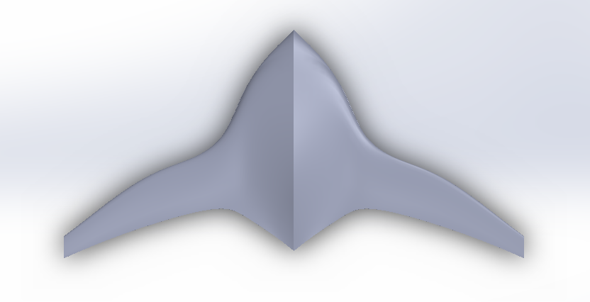
        </a>
        <figcaption><strong>Planform CAD</strong></figcaption>
      </figure>
      <figure class="figure-card">
        <a href="assets/bwb_new_cad_iso.png" target="_blank" rel="noopener noreferrer" aria-label="Open full-size isometric CAD view">
          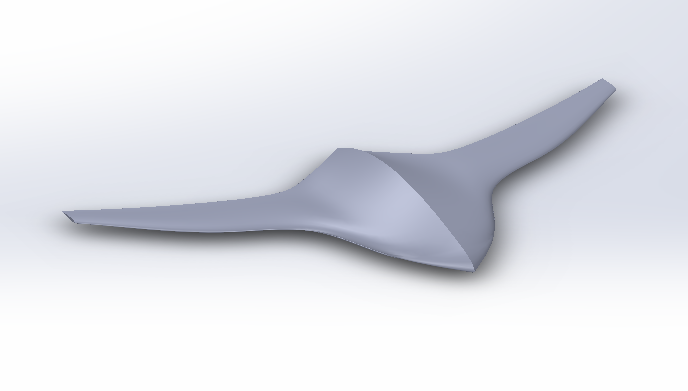
        </a>
        <figcaption><strong>Isometric CAD</strong></figcaption>
      </figure>
      <figure class="figure-card">
        <a href="assets/bwb_mh45_profile.png" target="_blank" rel="noopener noreferrer" aria-label="Open full-size MH45 airfoil profile">
          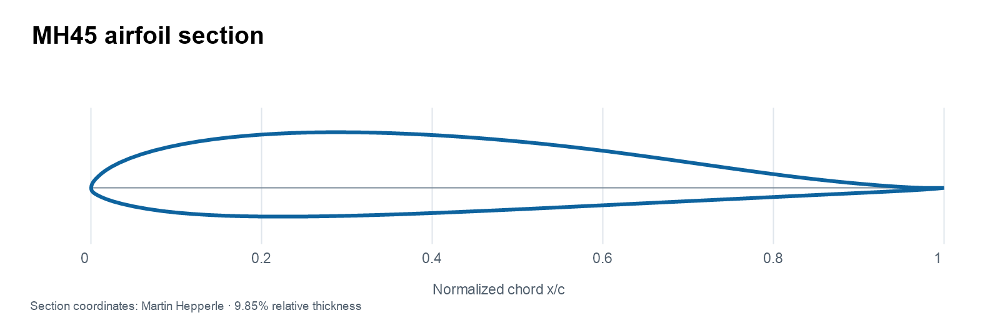
        </a>
        <figcaption><strong>MH45 airfoil</strong></figcaption>
      </figure>
    

  

  

    

      SECOND TEST / WIND-TUNNEL SWEEP
      <h3>Lift and efficiency across the measured angle range</h3>
      

        The new model was tested from −6° to 30° at 20–60 mph. Lift increases through most of the sweep,
        while the 28° to 30° points show a consistent high-angle roll-over. Peak L/D occurs at a lower angle
        than peak lift.
      

    

    

      <table class="bwb-re-table" aria-label="Airspeed and chord Reynolds number for the revised BWB wind-tunnel sweep">
        <tbody>
          <tr><th scope="row">Airspeed</th><td>20 mph</td><td>30 mph</td><td>40 mph</td><td>50 mph</td><td>60 mph</td></tr>
          <tr><th scope="row">Reynolds no.</th><td>≈35,000</td><td>≈53,000</td><td>≈70,000</td><td>≈88,000</td><td>≈106,000</td></tr>
        </tbody>
      </table>
    

    
Chord-based Reynolds number is dimensionless. Run 4 medians use an estimated 60.2 mm mean chord.

    

      <figure class="figure-card bwb-performance-plot">
        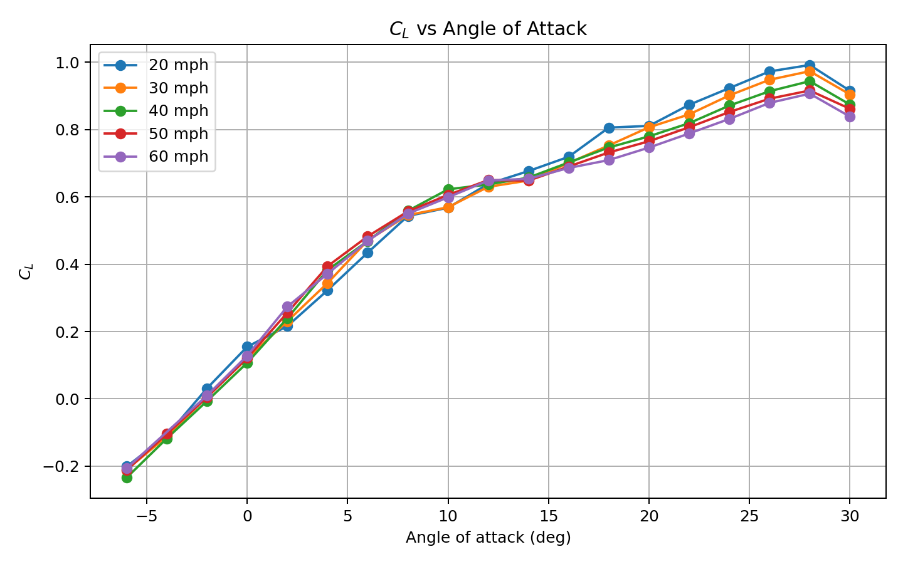
        <figcaption><strong>Lift.</strong> New-configuration wind-tunnel sweep.</figcaption>
      </figure>
      <figure class="figure-card bwb-performance-plot">
        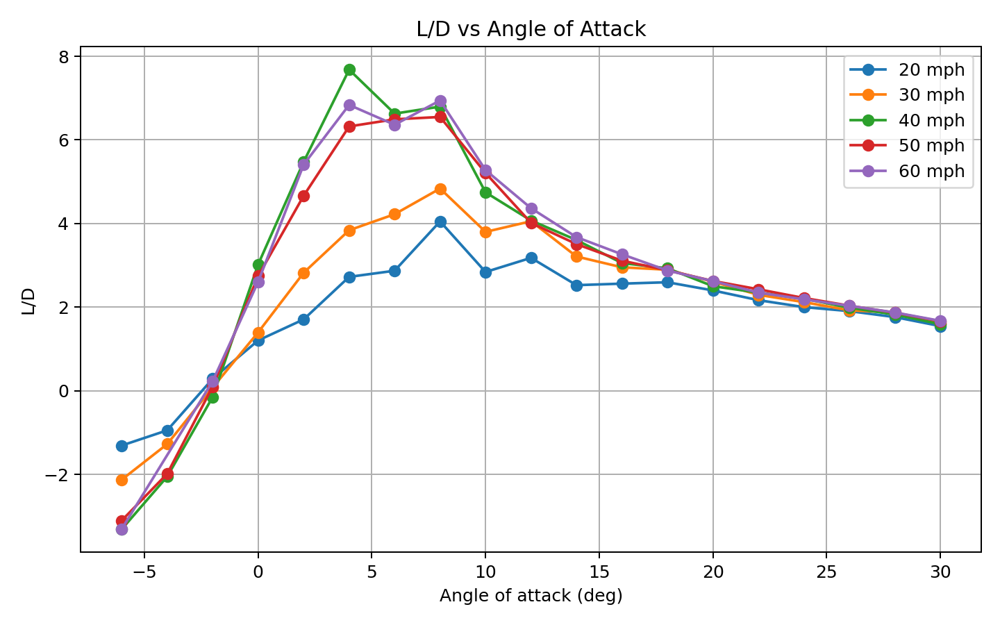
        <figcaption><strong>Efficiency.</strong> L/D across the same angle and speed range.</figcaption>
      </figure>
    

  

  

    

      SECOND TEST / MOBILE RIG
      <h3>A second way to observe the model in motion</h3>
      

        I mounted the revised model above a small wheeled platform and ran it outdoors.
        The rig and video document a qualitative physical test; the wind tunnel is the source of measured aerodynamic data.
      

    

    

      <figure class="figure-card">
        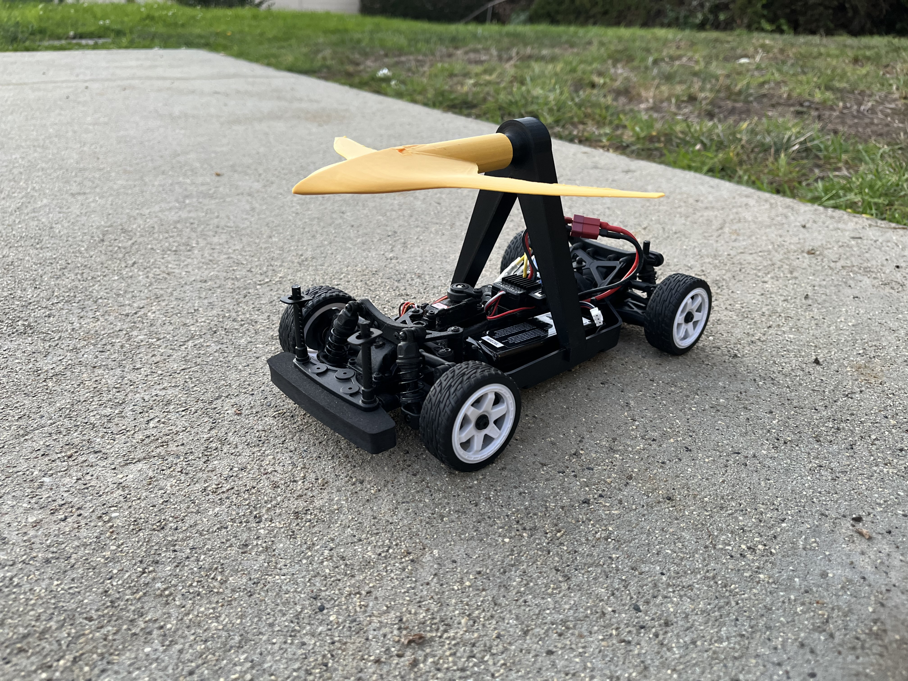
        <figcaption><strong>Test rig.</strong> The revised model mounted above the wheeled platform.</figcaption>
      </figure>
      <figure class="figure-card">
        <video controls playsinline preload="metadata" poster="assets/bwb_mobile_rig.jpg"
               aria-label="Outdoor run of the blended-wing-body mobile test rig">
          <source src="assets/bwb_mobile_rig_run.mp4" type="video/mp4">
          Your browser does not support this video.
        </video>
        <figcaption><strong>Outdoor run.</strong> The mobile rig carrying the model.</figcaption>
      </figure>
    

  

  

    

      ORIGINAL MODEL / FIRST TEST
      <h3>CFD and tufts revealed inboard-first separation</h3>
      

        I simulated the original model from −2° to +8°, then tested a 1:1 FDM article in the tunnel through 20°.
        At 14–16°, the tufts show separation starting near the centerbody while the outer panels remain partly attached.
        That finding informed the revised model above. These are separate test campaigns.
      

    

    

      <figure class="figure-card bwb-cfd-overview">
        
        <figcaption><strong>CFD.</strong> Velocity and pressure at 0°, 4°, and 8°.</figcaption>
      </figure>

      

        <figure>
          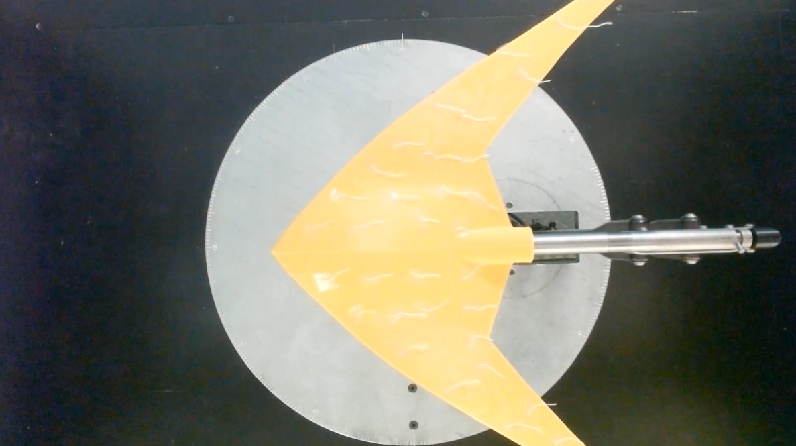
          <figcaption><strong>0–4°</strong>Attached</figcaption>
        </figure>
        <figure>
          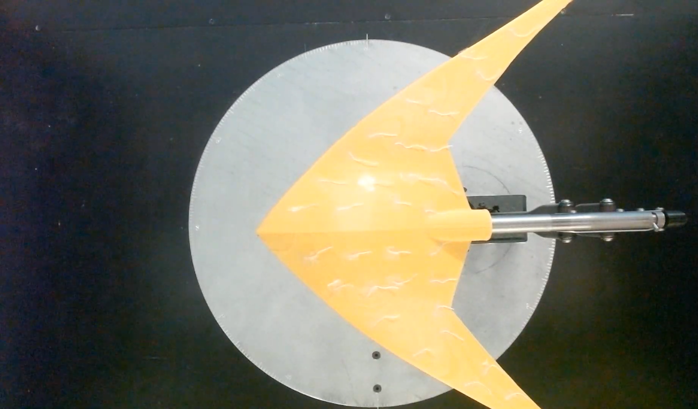
          <figcaption><strong>6–10°</strong>Inboard disturbance</figcaption>
        </figure>
        <figure>
          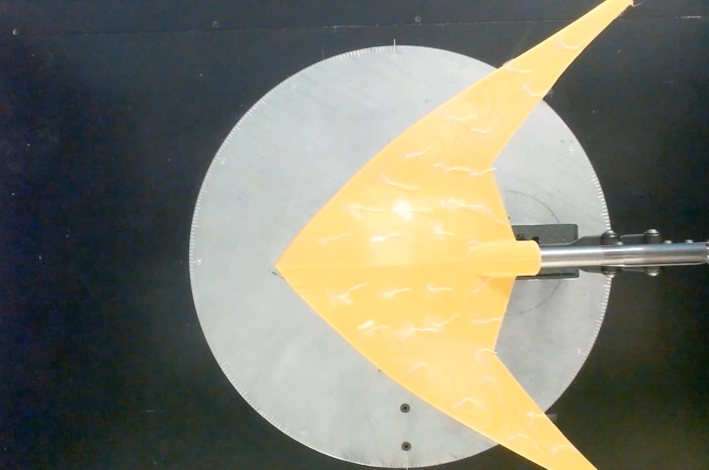
          <figcaption><strong>14–16°</strong>Centerbody separation</figcaption>
        </figure>
        <figure>
          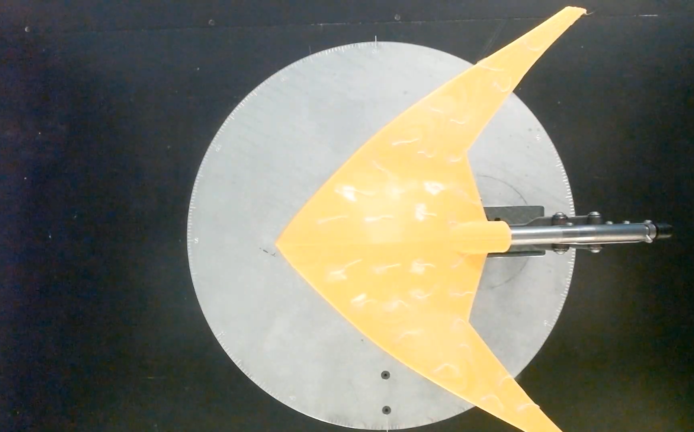
          <figcaption><strong>18–20°</strong>Progressive separation</figcaption>
        </figure>
      

    

  

  

    
Technical appendix — first-test CFD coefficient sweep

    

      

        <table>
          <thead>
            <tr><th>AoA</th><th>CL</th><th>CD</th><th>L/D</th></tr>
          </thead>
          <tbody>
            <tr><td>−2°</td><td>−0.0414</td><td>0.0283</td><td>−1.46</td></tr>
            <tr><td>0°</td><td>0.0586</td><td>0.0272</td><td>2.15</td></tr>
            <tr><td>2°</td><td>0.1612</td><td>0.0307</td><td>5.25</td></tr>
            <tr><td>4°</td><td>0.2598</td><td>0.0373</td><td>6.97</td></tr>
            <tr><td>6°</td><td>0.3554</td><td>0.0486</td><td><strong>7.31</strong></td></tr>
            <tr><td>8°</td><td>0.4473</td><td>0.0644</td><td>6.95</td></tr>
          </tbody>
        </table>
      

  

    <a href="assets/BWB_CFD_Summary_.pdf">CFD summary PDF ↗</a>
    <a href="assets/BWB_Project_Showcase_Tufts%20(4).html">Full project showcase ↗</a>
  

  

</section>

<section id="rotorcraft" class="case-study compact-case">
  <header class="case-header split">
    

      
RESEARCH · FLIGHT DYNAMICS

      <h2>Learned Aerodynamic Force &amp; Moment Models for Controller-Facing Simulation</h2>
      
Physics-informed force/moment modeling · nonlinear 6-DOF rollout · local stability · LQR tracking

    

IEEE Aerospace 2027 · Accepted

  </header>

  

    

      

        I am developing physics-informed AH-1S rotorcraft surrogates that learn aerodynamic force and moment maps
        while retaining the nonlinear rigid-body equations of motion.
        The research asks whether a learned model preserves flight behavior under trajectory rollout,
        local linearization, stability analysis, and feedback tracking—not only whether it matches one-step data.
      

  

    <article>
      01
      <h3>Physics-informed 6-DOF simulator</h3>
      

        Built a PyTorch/JSBSim pipeline coupling learned force/moment maps to nonlinear rigid-body dynamics
        across 56 maneuver trajectories, 8 aircraft states, and multiple speed regimes.
      

    </article>

    <article>
      02
      <h3>Rollout + local dynamic fidelity</h3>
      

        A past-12 temporal model cut held-out rollout geomean RMSE from 0.06498 to 0.02293 (64.7%);
        GroupDRO reduced mean locally unstable-mode incidence from 0.771 to 0.302 (60.8%).
      

    </article>

    <article>
      03
      <h3>Controller-facing validation</h3>
      

        Developed local A/B Jacobian, eigenmode, and paired LQR tracking tests across 27 cases;
        leading variants achieved about 0.91× baseline tracking error with no observed divergence in nonideal tests.
      

    </article>
  

  

    <strong>Accepted abstract:</strong>
    “From Accurate Predictions to Controller-Facing Learned Rotorcraft Surrogates: Stability &amp; Tracking.”
  

<figure class="figure-card rotorcraft-figure">
  <video autoplay muted loop playsinline controls preload="metadata"
         aria-label="Matched AH-1S recovery comparison across open-loop and neural controllers">
    <source src="assets/ah1s_matched_recovery_20s.mp4" type="video/mp4">
    Your browser does not support the video tag.
  </video>
  <figcaption>
    <strong>Matched recovery comparison.</strong>
    Open loop, compact neural, raw-history neural, and quadratic-load controllers are compared on
    <code>confirmation_046</code>, the largest completed open-loop-error case among the 48 locked trials,
    selected without considering which model won. This is a 20-second slow-motion presentation of a
    2-second JSBSim recovery in physical time, not a new 20-second experiment. Spatial displacement is
    reconstructed by integrating the velocity-error channels. Position is magnified 1000× and attitude
    120×, with both scale factors shown throughout.
  </figcaption>
</figure>

  

</section>

<section id="hycube" class="case-study compact-case">
  <header class="case-header">
    

      
NASA MINNESOTA SPACE GRANT · UMN SMALL SATELLITE PROGRAM

      <h2>HyCUBE Hypersonic Reentry Vehicle</h2>
      
Thermal instrumentation · calibration · payload integration · high-altitude flight operations

    

  </header>

  

    <figure class="figure-card">
      
      <figcaption><strong>High-altitude flight.</strong> HyCUBE payload during the balloon mission.</figcaption>
    </figure>

<figure class="figure-card">
  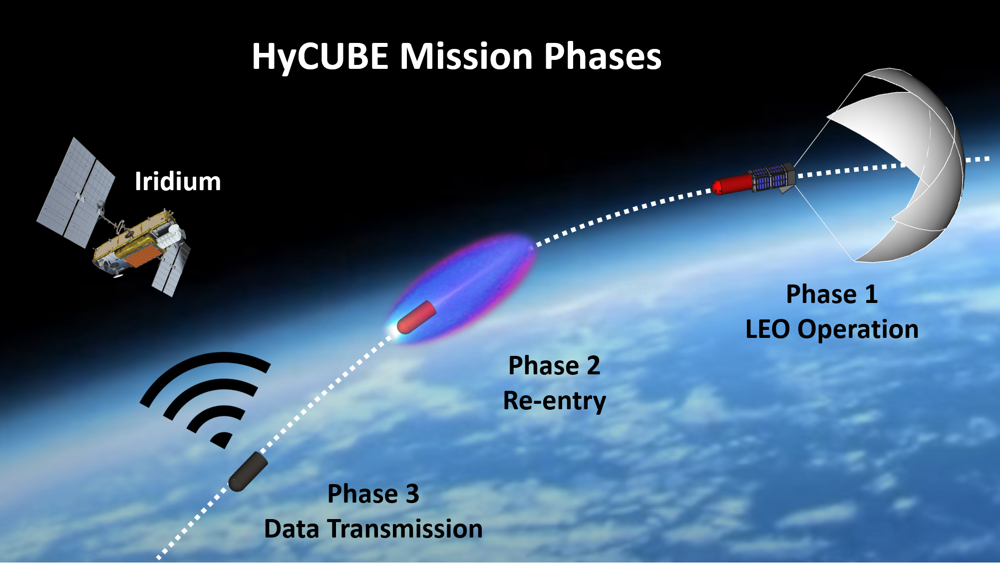
  <figcaption><strong>Mission architecture.</strong> Balloon ascent, release, reentry experiment, and Iridium data return.</figcaption>
</figure>

  

  

    

      

        Hypersonic entry exposes vehicles to extreme aerothermal heating, making reliable temperature measurements essential for validating thermal-protection-system performance.
        Built, wired, and programmed a thermocouple calibration rig for flight instrumentation,
        then characterized probe configurations against a reference and supported payload integration,
        high-altitude flight operations, recovery, and post-flight validation.
      

  

    <article>
      <h3>Calibration &amp; analysis</h3>
      
Used Arduino DAQ and cold-junction compensation to characterize probes from 50–155°C with regression and agreement analysis.

    </article>
    <article>
      <h3>Flight integration</h3>
      
Secured payload hardware, tracked Iridium telemetry to approximately 90,000 ft, recovered the payload, and validated post-flight data.

    </article>
  

  

    

      <strong>50–155°C</strong>
      probe characterization range
    

    

      <strong>~90,000 ft</strong>
      high-altitude flight and recovery
    

  

<figure class="figure-card hycube-plot-card">
  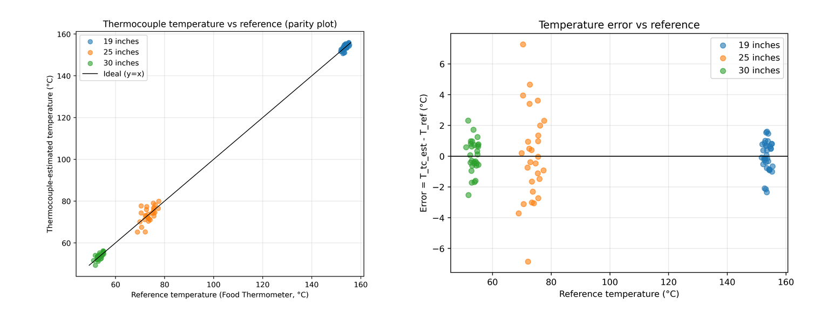
  <figcaption><strong>Calibration validation.</strong> Parity and residual error across the 50–155°C probe-characterization range.</figcaption>
</figure>

<figure class="figure-card hycube-ground-photo">
  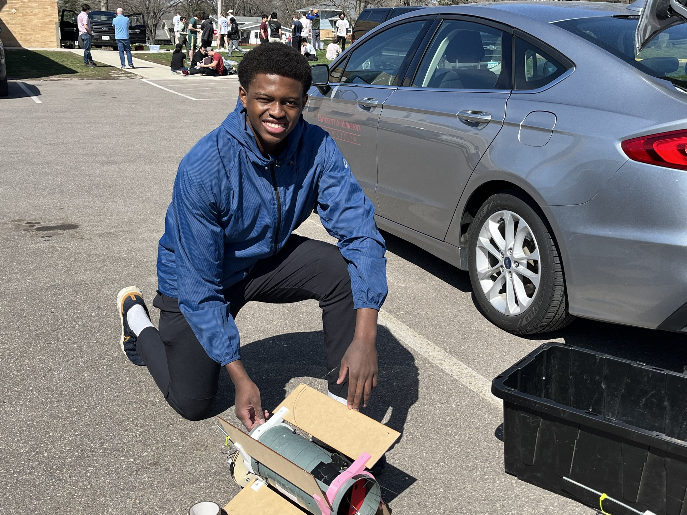
  <figcaption><strong>Preflight integration.</strong> Securing payload hardware before balloon release.</figcaption>
</figure>

<figure class="figure-card hycube-plot-card secondary">
  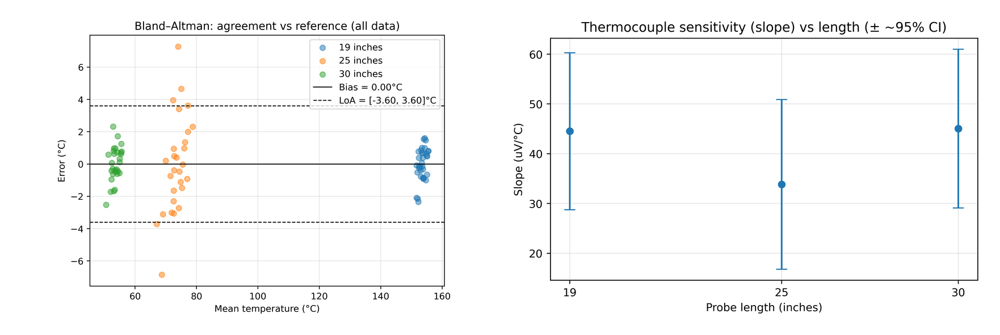
  <figcaption><strong>Agreement + sensitivity.</strong> Bias, limits of agreement, and fitted sensitivity across probe configurations.</figcaption>
</figure>

  

</section>

<section id="drone" class="case-study compact-case">
  <header class="case-header">
    

      
MECHANICAL INTEGRATION · MECHANISM DESIGN · FLIGHT TEST

      <h2>Drone Payload Integration: Mechanism, CFD &amp; Flight Test</h2>
      
CAD · mechanism design · mechanical integration · DfAM · CFD analysis · loaded flight testing

    

  </header>

  

    <figure class="figure-card drone-cad-card">
      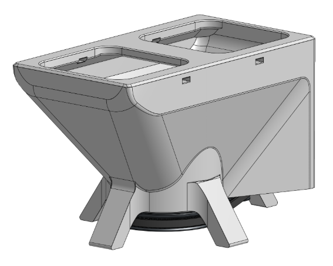
      <figcaption><strong>Integrated CAD.</strong> ABS-printed hopper/body, mounting interface, and service-access geometry.</figcaption>
    </figure>
    <figure class="figure-card drone-flight-card">
      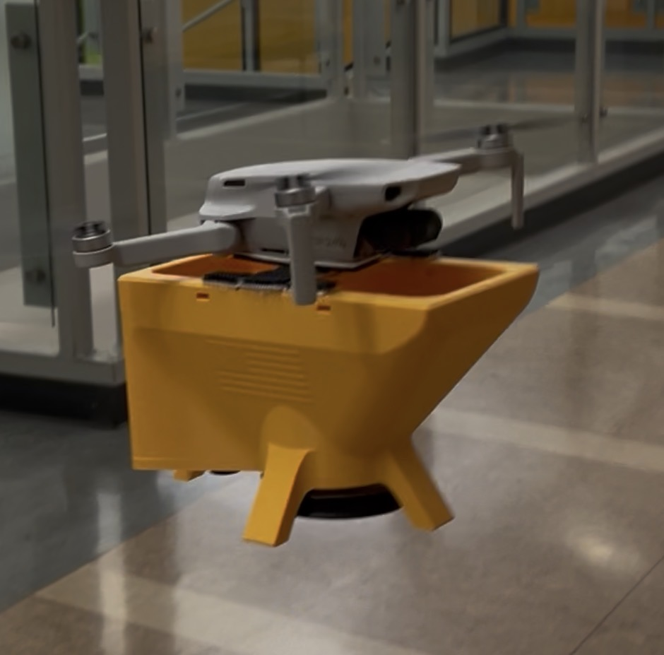
      <figcaption><strong>Loaded flight validation.</strong> Complete attachment mounted under the DJI quadcopter during indoor testing.</figcaption>
    </figure>
  

  

    
<strong>15 mph</strong>CFD forward-flight condition

    
<strong>3.94 N</strong>predicted drag

    
<strong>0.926 N</strong>predicted lift

    
<strong>−0.044 N</strong>predicted side force

  

  

    

      

        External payloads can alter an aircraft’s mass distribution, aerodynamics, stability, and controllability,
        so the attachment had to be engineered as part of the flight vehicle.
        On a four-person team, I owned mounting placement, aerodynamic outer geometry, maintenance access,
        and DfAM for a 418 g ABS-printed seed-dispersal attachment, then validated retention and aircraft integration
        on a DJI quadcopter through loaded flight testing.
      

      

        I ran a 15 mph CFD study that predicted 3.94 N drag, 0.926 N lift, and −0.044 N side force.
        The initial geometry showed unfavorable leading-edge separation, so I redesigned the forward face
        from flat to curved to improve aerodynamic integration before final flight testing.
      

      

        The payload also required a compact dispensing mechanism: a gravity-fed hopper/ramp with a belt-driven drivetrain,
        4.875:1 HTD reduction (16T → 78T), printed pulleys, interference-fit bearings,
        and a custom shaft/bearing stack packaged beneath the hopper.
      

    

<figure class="figure-card drone-cfd-pair">
  

    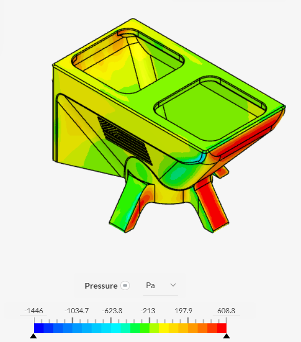
    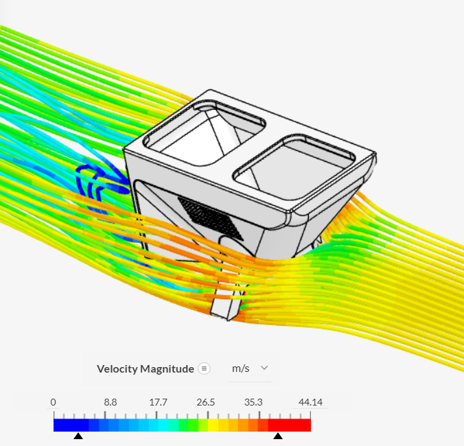
  

  <figcaption><strong>15 mph CFD.</strong> Pressure and velocity fields used to quantify loads and drive the leading-edge redesign.</figcaption>
</figure>

  

</section>

<footer class="portfolio-footer">
  Kevin Armstrong II · UC Berkeley Mechanical Engineering
  

    <a href="https://mail.google.com/mail/?view=cm&amp;fs=1&amp;to=kevarm2028@berkeley.edu"
       target="_blank" rel="noopener noreferrer">Email</a>
    <a href="https://www.linkedin.com/in/kevin-armstrong-ii-647125319/"
       target="_blank" rel="noopener noreferrer">LinkedIn</a>
  

</footer>
